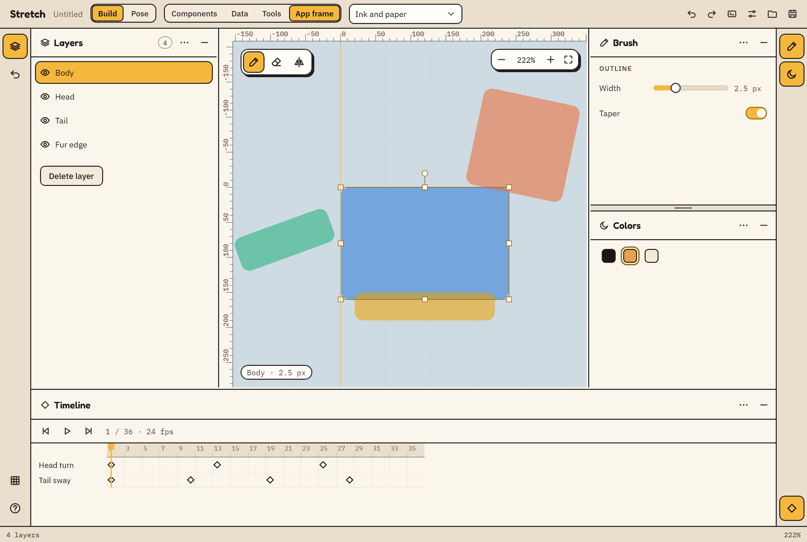
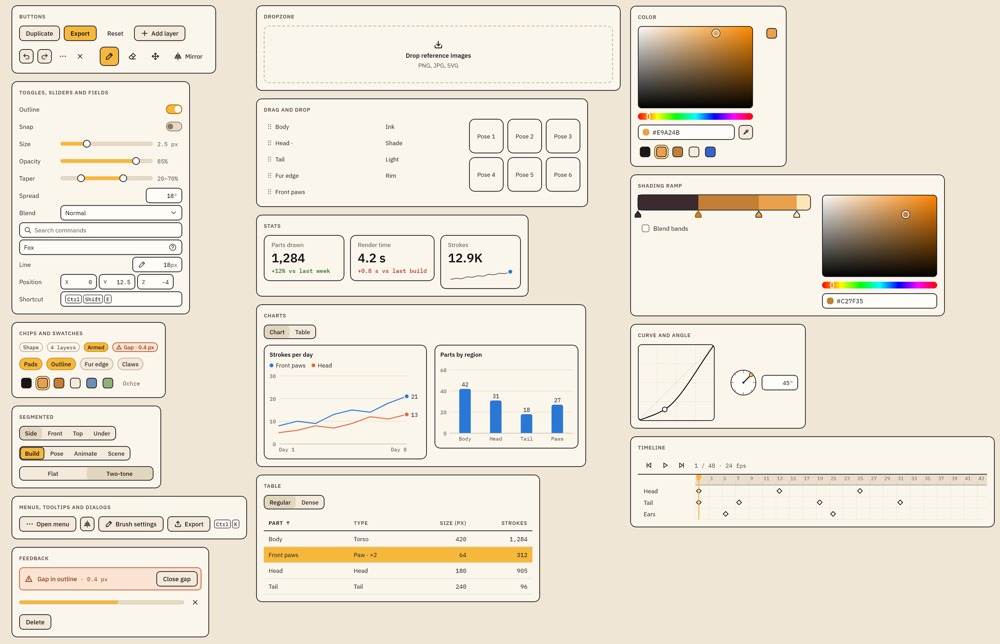
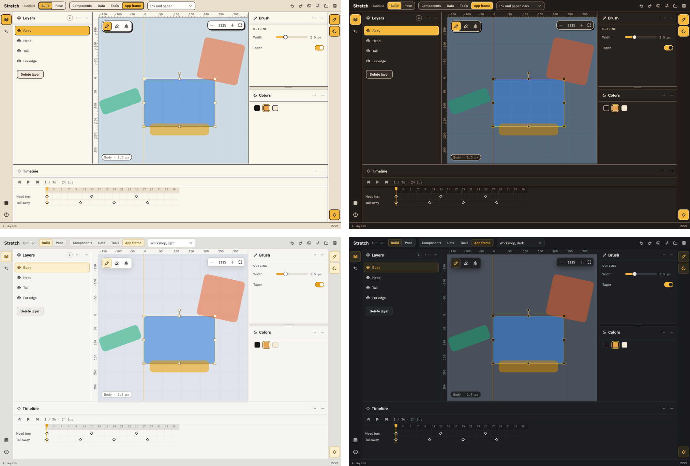
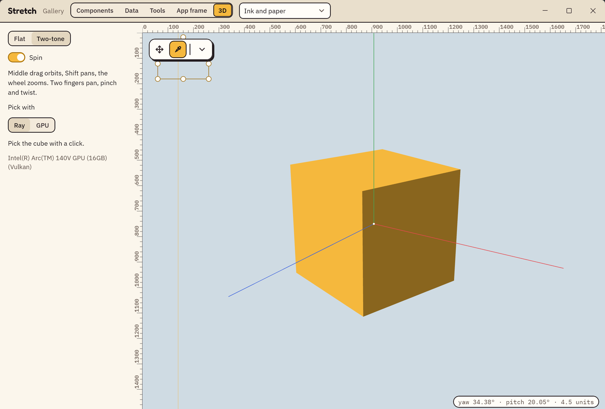

# Stretch

A shared app shell for creative desktop tools, built on Kotlin and Compose Multiplatform. Stretch brings the design system, the components, the app frame and the plumbing every creative tool needs. An app picks a theme and adds only what is its own.



Stretch holds no domain logic. It never knows what a document, a layer or a character is, so the same shell can carry a drawing tool, an animation tool or a 3D editor.

## What's in it

- **An app frame.** Top bar, modes, rails, resizable side and bottom drawers, a status bar and a viewport with rulers, guides, selection handles and a marquee.
- **Components for tools.** The everyday controls, plus the ones creative tools need: a color picker, shading ramp, curve editor, angle dial, timeline, vector field and key capture field.
- **App plumbing.** Commands, undo with gestures, a keymap with an opt-in editor, a command palette, a session log, and one open document with save prompts, recent files and crash recovery.
- **Pen and touch.** Pressure and tilt through Windows Ink, and two-finger pan, pinch and twist in the viewport.
- **One identity.** A Gradle plugin gives an app one name, id and icon across its installer, launcher, taskbar and windows.



## Themes

A theme is more than a palette: it also sets border weight, corner radii, display face and shadow style. Stretch ships four, each tested against contrast checks. It can follow the OS's light or dark appearance, and it scales the whole interface to the size a person picks.



### Make it yours

The four themes are a starting point, not a limit. Components read only design tokens, so an app's own theme restyles every one of them. Start from a shipped theme or define every token yourself:

```kotlin
val leaf = Color(0xFF6FBF73)

val Forest = StretchThemes.WorkshopDark.copy(
    id = "forest",
    name = "Forest",
    colors = StretchThemes.WorkshopDark.colors.copy(
        accent = leaf, toggleOn = leaf, focus = leaf, // and the rest of your palette
    ),
    shapes = StretchShapes(seg = 2.dp, ctl = 2.dp, row = 2.dp, card = 4.dp),
    stroke = 2.dp,
)

StretchTheme(Forest) { /* your app */ }
```

## 3D viewports

An app can put a native GPU surface inside the frame, with the rulers, toolbars and readouts still around and over it. The surface doesn't assume a graphics API, so any renderer can implement it. The optional `stretch-gpu` module adds a WebGPU API over wgpu-native, an orbit camera with mouse and touch navigation, overlays for gizmos, and picking by ray or on the GPU. The base modules stay free of GPU dependencies.



## Try it

You need JDK 25 for Gradle. Gradle fetches the rest, including the JetBrains Runtime the gallery runs on.

```
./gradlew :gallery:run         # every component in every theme, and an app frame demo
./gradlew :gallery:run -Pgpu   # adds the 3D page (Windows, needs a GPU)
```

## Build an app on it

Stretch is published to GitHub Packages. GitHub asks for a token to download packages, even public ones, so create one with the `read:packages` scope and put it in `~/.gradle/gradle.properties`:

```properties
GitHubPackagesUsername=<your GitHub username>
GitHubPackagesPassword=<your token>
```

Add the repository to your `settings.gradle.kts`:

```kotlin
dependencyResolutionManagement {
    repositories {
        mavenCentral()
        google()
        maven {
            name = "GitHubPackages"
            url = uri("https://maven.pkg.github.com/nrc4867/stretch")
            credentials(PasswordCredentials::class)
        }
    }
}
```

Then depend on `stretch-frame`, which brings the components, themes and core with it, along with Compose's desktop runtime:

```kotlin
dependencies {
    implementation("dev.chieppa.stretch:stretch-frame:<version>")
    implementation(compose.desktop.currentOs)
}
```

And start from a window:

```kotlin
fun main() = application {
    StretchWindow(onCloseRequest = ::exitApplication, title = "Fox") {
        StretchTheme(StretchThemes.system()) {
            Column(Modifier.fillMaxSize()) {
                WindowTopBar("Fox", "Untitled")
                Viewport(Modifier.weight(1f)) {
                    // Your canvas, or a NativeSurface for a GPU renderer.
                }
            }
        }
    }
}
```

[Using Stretch from an app](docs/using-stretch.md) covers the viewport, GPU surfaces, documents, the clipboard, macOS and app identity.

## How it's organized

| Module | Holds |
| --- | --- |
| `stretch-core` | Commands, undo, the session log, actions and keymap |
| `stretch-theme` | Design tokens, themes, fonts and icons |
| `stretch-ui` | Components |
| `stretch-frame` | The app frame, overlays and viewport |
| `stretch-document` | One open document: saving, recent files and crash recovery |
| `stretch-input` | Pointer and pen samples |
| `stretch-gpu`, `stretch-gpu-native` | Optional WebGPU viewports and their wgpu-native bindings |
| `stretch-gradle-plugin` | App name, id and icon |
| `stretch-test` | Command scenarios and Compose UI test helpers |
| `gallery` | Every component in every theme |

To work on Stretch itself, see [Developing Stretch](docs/development.md).

## Platforms

Stretch runs on the desktop JVM. Windows has everything: the custom title bar, pen, touch and GPU surfaces. macOS has the custom title bar, the native menu bar and Mac key symbols. Linux has the app and its components with the system title bar and mouse input.

## License

`AGPL-3.0-only`; see `LICENSE` and `NOTICE`. Contributions need the CLA in `CLA.md`. Bundled fonts are under the SIL Open Font License (`licenses/`).
